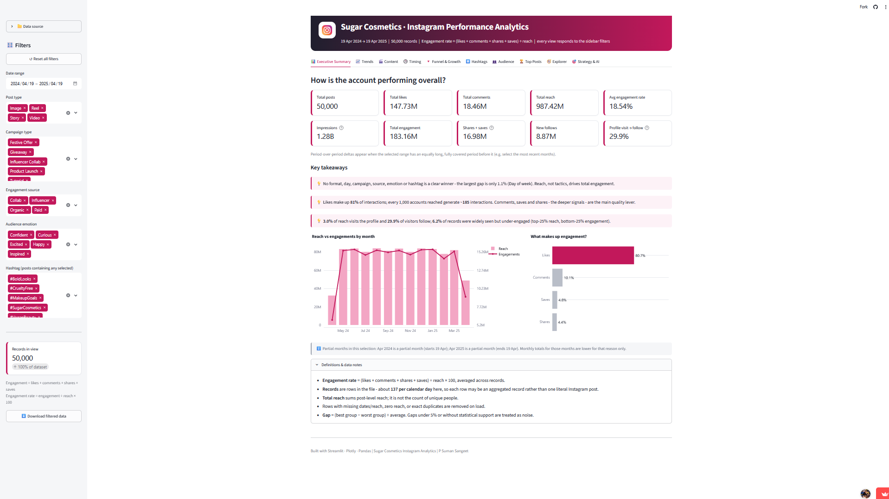
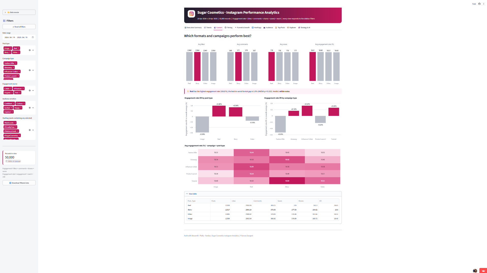
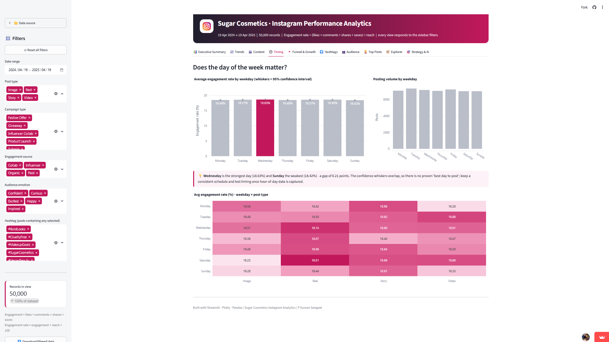
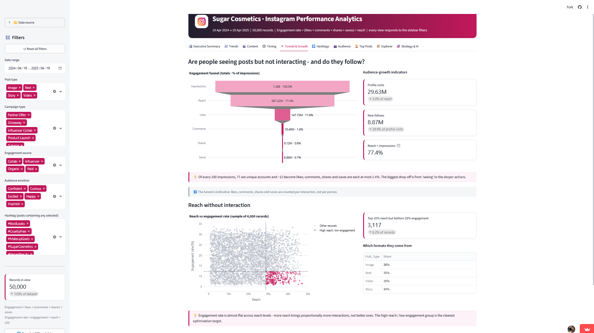
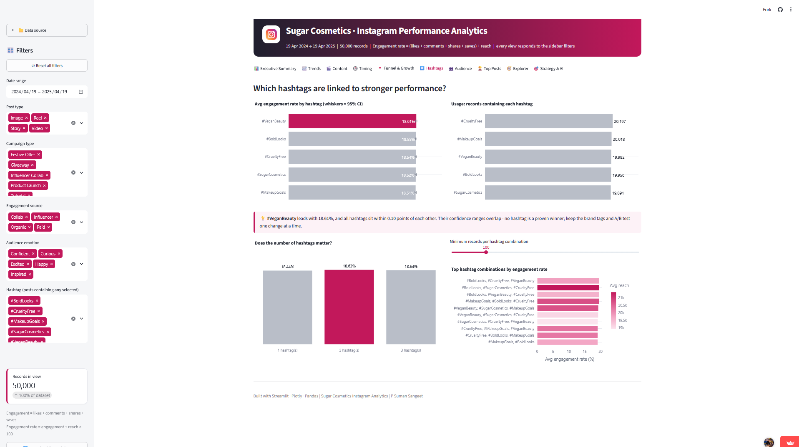
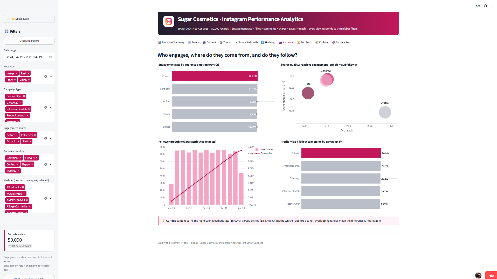
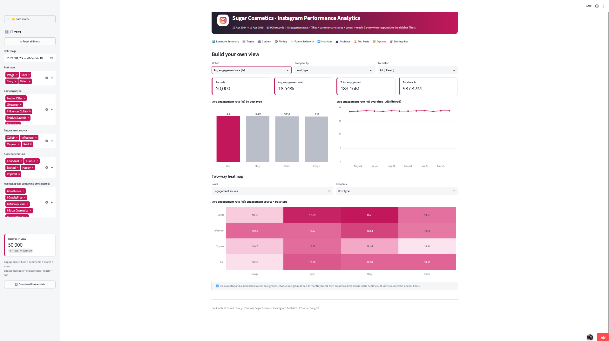
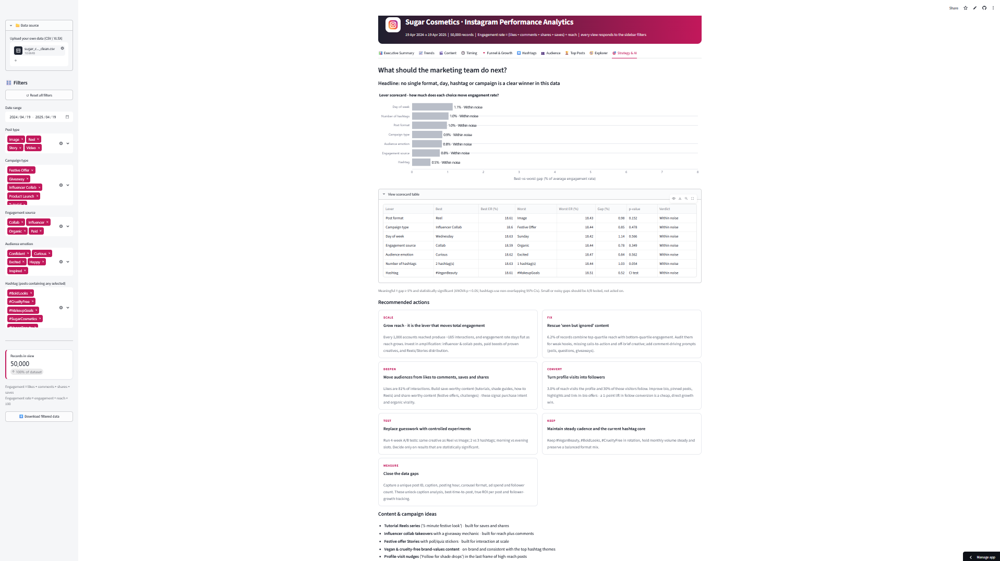

# Sugar Cosmetics · Instagram Performance Analytics (Streamlit)

# 💄 SUGAR Cosmetics — Instagram Performance Analytics

### Transforming Social Media Data into Actionable Marketing Insights

<p align="center">
  <strong>Data Analytics with AI | LABMENTIX | Project 13.1</strong>
</p>

<p align="center">
  <a href="https://sugar-cosmetics-instagram-performance-analytics-jausdzg2vtd5fm.streamlit.app/">
    
  </a>
  
  
</p>

---

## 📌 Executive Summary

**Instagram Performance Analytics for SUGAR Cosmetics** is a data analytics project designed to transform social media performance data into meaningful business insights.

The project focuses on evaluating content performance, understanding engagement patterns, identifying trends, and supporting data-driven marketing decisions through interactive visualizations and an accessible web application.

The goal is to help translate social media metrics into practical recommendations for content planning, audience engagement, campaign evaluation, and digital marketing optimization.

### 🚀 Explore the Live Application

**[Launch the Interactive Dashboard →](https://sugar-cosmetics-instagram-performance-analytics-jausdzg2vtd5fm.streamlit.app/)**

Explore the deployed Streamlit application to experience the project's available analytical views and interactive features.

---

## 🎯 Business Problem

Social media teams generate substantial amounts of performance data, but individual metrics do not always explain which content strategies are most effective.

Marketing decision-makers need to understand:

- Which content formats attract stronger audience interactions?
- How do likes, comments, shares, and saves vary across posts?
- Which campaigns or content categories demonstrate stronger performance?
- How does engagement change over time?
- Which findings can inform future content planning and optimization?

This project addresses these analytical questions by organizing social media data into visual insights that can support business decisions.

## 🎯 Project Objectives

- Measure Instagram content performance using relevant KPIs.
- Analyze engagement patterns across available content categories.
- Compare post performance and identify high-performing content.
- Explore publishing trends and performance changes over time.
- Evaluate campaign, hashtag, or audience patterns where supported by the data.
- Develop evidence-based marketing recommendations.
- Present the analysis through a clean, interactive dashboard.

## 📊 Analytical Framework

The project is organized around the following business intelligence perspectives. The exact metrics and views depend on the fields available in the dataset and the implemented application.

| Analytical Area | Business Questions | Potential Visualizations |
|---|---|---|
| Executive Overview | What does overall performance look like? | KPI cards and trend charts |
| Content Performance | Which posts and formats perform best? | Ranked bar charts and comparisons |
| Engagement Analysis | How do audiences interact with content? | Engagement breakdowns and comparisons |
| Time-Based Trends | How does performance change over time? | Line charts and weekday analysis |
| Campaign Analysis | Which campaign categories perform well? | Comparative charts |
| Hashtag Analysis | Which hashtags are associated with stronger engagement? | Ranked comparisons |
| Business Insights | What actions should marketing teams consider? | Insight summaries and recommendations |

*These are analytical categories, not a claim that every listed chart is currently implemented in the live app.*

## 📈 Key Performance Indicators

Depending on the available dataset, relevant KPIs may include:

- **Total Posts:** Number of posts analyzed.
- **Total Likes:** Aggregate likes across analyzed posts.
- **Total Comments:** Aggregate comments across analyzed posts.
- **Total Engagements:** Sum of supported engagement actions.
- **Average Engagement per Post:** Average interactions per post.
- **Reach:** Unique accounts reached, when available.
- **Impressions or Views:** Exposure metrics, according to the dataset's definitions.
- **Engagement Rate:** Engagement relative to a clearly specified denominator.

### Engagement Rate

For a reach-based engagement rate, a commonly used definition is:

`Engagement Rate (%) = Total Engagements / Total Reach × 100`

The calculation should use compatible, consistently defined measures and an appropriate aggregation method. A follower-based engagement rate uses followers as the denominator instead.

**Metric integrity:** The formula and denominator should be documented in the dashboard. Avoid treating reach, impressions, views, and followers as interchangeable measures.

## 🖥️ Live Dashboard

The project is deployed using Streamlit.

**[Open SUGAR Cosmetics Instagram Analytics](https://sugar-cosmetics-instagram-performance-analytics-jausdzg2vtd5fm.streamlit.app/)**

## 📊 Dashboard Preview

Explore the interactive **SUGAR Cosmetics Instagram Performance Analytics** application.

**[🚀 Launch the Live Dashboard](https://sugar-cosmetics-instagram-performance-analytics-jausdzg2vtd5fm.streamlit.app/)**

### 1. 📊 Executive Summary



*Review the principal performance indicators and overall Instagram analytics summary.*

### 2. 📈 Trends


*Explore performance patterns and changes across the available reporting periods.*

### 3. 🎬 Content



*Analyze content performance across the available post formats and categories.*

### 4. 🕒 Timing



*Explore publishing-time patterns and identify opportunities to optimize scheduling.*

### 5. 🔻 Funnel & Growth



*Examine available funnel metrics, engagement progression, and growth indicators.*

### 6. #️⃣ Hashtags



*Evaluate hashtag performance and identify patterns associated with content engagement.*

### 7. 👥 Audience



*Explore audience-related metrics and available segmentation insights.*

### 8. 🏆 Top Posts


*Review leading posts using the performance measures available in the application.*

### 9. 🧭 Explorer



*Explore the underlying data using the filters and interactive controls provided by the dashboard.*

### 10. 🎯 Strategy & AI



*Explore the strategy and AI-assisted insights available in the application to support marketing analysis and decision-making.*

---

**Note:** Dashboard interpretations depend on the underlying dataset, implemented metrics, and available features. The screenshots should be captured from the actual deployed application.

> Replace the example paths with the actual screenshot filenames committed to `screenshots/`. If a screenshot has not been created, remove its image reference until it is available.

## 🔍 From Analytics to Business Decisions

The project uses a business-oriented approach to interpreting data.

| Analytical Observation | Evidence to Evaluate | Potential Business Action |
|---|---|---|
| Content formats perform differently | Average engagement and engagement rate by format | Allocate content production based on measured results |
| Engagement varies across posts | Likes, comments, shares, saves, and reach | Investigate characteristics of leading posts |
| Performance changes over time | Trends by date, month, or weekday | Test a more structured publishing calendar |
| Campaign categories differ | Comparable campaign-level KPIs | Review campaign creative and distribution strategy |
| Hashtags show different performance | Hashtag-level metrics with adequate sample sizes | Test relevant hashtags and measure results |

These are decision frameworks. Final findings should be based on the actual dashboard outputs rather than assumed results.

## 💡 Business Value

The project demonstrates how social media analytics can help organizations:

- Establish a structured approach to performance measurement.
- Compare content using consistent KPIs.
- Identify patterns that merit further investigation.
- Communicate analytical findings through visual storytelling.
- Translate observations into measurable marketing experiments.
- Support more informed content and campaign planning.

Recommendations should be validated against additional periods and, where possible, controlled experiments before making causal claims about engagement or marketing ROI.

## ⚙️ Project Workflow

1. **Data understanding:** Review available fields, data types, and analytical objectives.
2. **Data preparation:** Inspect missing values, duplicates, formatting issues, and data consistency.
3. **Exploratory Data Analysis:** Examine distributions, trends, and relationships.
4. **KPI development:** Define engagement metrics and calculation rules.
5. **Visual analytics:** Build charts and comparisons aligned with business questions.
6. **Application development:** Present the analysis through the deployed Streamlit application.
7. **Business interpretation:** Convert supported findings into recommendations.
8. **Documentation:** Publish the project workflow, dashboard screenshots, and supporting resources.

## 🛠️ Technology Stack

The following tools should be listed only where they were actually used in the implementation.

- **Application:** Streamlit
- **Data manipulation:** Python, Pandas, NumPy
- **Visualization:** Plotly, Matplotlib, or Seaborn, as applicable
- **Data source and storage:** CSV, Excel, or other implemented sources
- **Development and documentation:** Jupyter Notebook, Git, and GitHub, where applicable

## 📂 Repository Structure

The repository can be organized as follows, adapted to the files included in the final upload.

```text
sugar-cosmetics-instagram-analytics/
│
├── app.py
├── README.md
├── requirements.txt
├── .gitignore
│
├── data/
│   ├── raw/
│   └── processed/
│
├── notebooks/
│
├── src/
│
├── screenshots/
│   ├── overview.png
│   ├── content-performance.png
│   ├── engagement-trends.png
│   └── business-insights.png
│
└── reports/
    ├── business-summary.pdf
    └── insights-report.pdf
```

*This is a suggested structure. Keep only files and folders that exist in your repository; adjust names to match your implementation.*

## ▶️ Run the Application Locally

To run the application locally, clone your repository and install the project's dependencies.

```bash
git clone https://github.com/YOUR-USERNAME/sugar-cosmetics-instagram-analytics.git

cd sugar-cosmetics-instagram-analytics

python -m venv .venv
```

Activate the virtual environment on Windows:

```bat
.venv\Scripts\activate
```

Install dependencies and start the app:

```bash
pip install -r requirements.txt

streamlit run app.py
```

Replace `YOUR-USERNAME` with your GitHub username. Ensure the repository contains `app.py` at the root and a complete `requirements.txt`; adjust the command if your entry point has a different name.

## 📋 Data Quality, Limitations & Responsible Interpretation

- Document the source and time period of the dataset.
- Distinguish observed metrics from estimates or synthetic sample data.
- Define the denominator and aggregation method for each engagement metric.
- Account for missing values and duplicate records during analysis.
- Avoid causal claims based solely on descriptive comparisons.
- Do not publish confidential account information, access tokens, or restricted datasets.
- Treat marketing ROI as unverified unless campaign costs and conversion outcomes are available.

This project is intended for educational and portfolio demonstration purposes. SUGAR Cosmetics is referenced as the subject of analysis; the project does not imply official affiliation, endorsement, or access to proprietary company analytics.

## 👨‍💻 Author

**P Suman Sangeet**

PGDM — Big Data Analytics

**Areas of Interest:** Data Analytics | Business Intelligence | Data Visualization | Marketing Analytics

**Tools:** Python | SQL | Excel | Power BI | Tableau

## 🔗 Project Links

- **Live Streamlit Application:** [Open Dashboard](https://sugar-cosmetics-instagram-performance-analytics-jausdzg2vtd5fm.streamlit.app/)
- **GitHub Repository:** Add your repository URL after publishing.
- **LinkedIn:** Add your professional profile URL.
- **Portfolio:** Add your portfolio URL, if available.

## ⭐ Project Takeaway

This project demonstrates an end-to-end analytical mindset: structuring social media data, evaluating relevant performance indicators, presenting patterns visually, and connecting analytical evidence to business decisions.

The emphasis is on clear metrics, interactive exploration, responsible interpretation, and actionable insights for digital marketing.

---

<p align="center">
  <strong>Turning Data into Insights. Turning Insights into Action.</strong>
</p>
